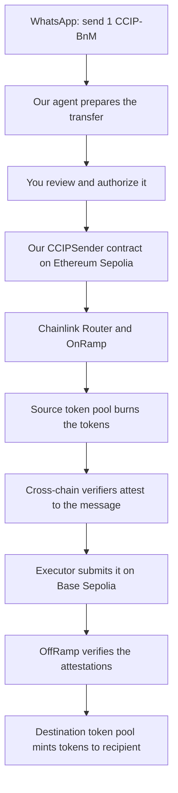

# Explain CCIP cross-chain flow

Session: `01a1b07a-6249-75f2-8c16-867089e659e0`

Historical transcript. Statements describe what was reported at the time.

## 2026-11-06T16:19:38+05:30 — User prompt

```text
I want to understand how is ccip exactly working like ik we are using it to send eth cross chain but likehow is it wkring

what simulator of it are we suing etc etc?

```

## 2026-11-06T16:19:41+05:30 — AI progress update

```text
I’ll look through the project to trace how CCIP moves ETH and identify the simulator and contracts you’re using. Then I’ll explain the flow step by step.

```

## 2026-11-06T16:20:19+05:30 — AI progress update

```text
The code shows an important distinction: this CCIP flow transfers **CCIP-BnM test tokens from Ethereum Sepolia to Base Sepolia**. ETH pays the fees. The tests use Chainlink’s official **Local Simulator 0.3.1**, which simulates delivery inside one local test environment. I’m checking that boundary so I can explain what happens locally versus on the public testnets.

```

## 2026-11-06T16:21:15+05:30 — AI response

````text
I checked the contracts, Python integration, and tests. **Our current CCIP flow sends CCIP-BnM test tokens from Ethereum Sepolia to Base Sepolia. ETH pays the fees; it is not the asset being transferred cross-chain.**

We’re using **Chainlink Local Simulator 0.3.1** for local contract tests, alongside **CCIP contracts 2.0.0**. Here’s how the pieces fit together.

## 1. What does “sending a token cross-chain” actually mean?

Ethereum Sepolia and Base Sepolia keep separate records of balances. A contract on Ethereum cannot directly change a balance on Base.

For **CCIP-BnM**, the transfer works through **burn and mint**:

1. Destroy—or **burn**—the specified tokens on the source chain.
2. Verify that the source-chain transfer happened.
3. Create—or **mint**—the corresponding tokens on the destination chain.

So, sending 1 CCIP-BnM means your source balance decreases by 1 and the recipient’s destination balance eventually increases by 1. Tokens do not physically travel between chains. The protocol coordinates those two balance changes. [Chainlink’s test-token explanation](https://docs.chain.link/ccip/getting-started/test-tokens)

**CCIP** stands for **Cross-Chain Interoperability Protocol**. It carries verifiable messages between chains. Those messages can transfer tokens, deliver instructions to a contract, or do both.

Our implementation uses it for a **token-only transfer**.

## 2. The actual public-testnet flow

This is the path our code is designed to use after deployment:



The Chainlink components have distinct jobs:

- **Router:** the contract our application calls to quote fees and submit a transfer.
- **OnRamp:** prepares the outbound message and coordinates the source-side token operation.
- **Token pool:** has permission to burn or mint the relevant token.
- **Cross-chain verifiers:** observe the source event and produce attestations—cryptographic evidence confirming the message.
- **Executor:** submits the message and attestations on the destination chain.
- **OffRamp:** checks that the required verification succeeds before permitting destination delivery.

The executor cannot simply choose to mint tokens. The destination contracts enforce the verification rules. [Chainlink’s CCIP 2.0 architecture](https://docs.chain.link/ccip/concepts/architecture/overview)

We deploy **our sender contract**. We use Chainlink’s existing testnet infrastructure for the other components.

## 3. What our own code does

Imagine you ask:

> Send 1 CCIP-BnM from Ethereum Sepolia to Alice on Base Sepolia.

### First, the agent prepares a review

The Python integration checks the network, configured sender contract, token balance, and existing spending permission. It asks the Router for a fee quote.

It shows you the recipient, amount, destination, fee limit, and transaction gas limit before requesting approval.

This orchestration lives in [agent/ccip.py](<project>/agent/ccip.py:106).

### Then, your wallet authorizes token spending

CCIP-BnM is an ERC-20 token, so our sender contract needs permission to take it from your wallet.

The first transfer can require two source-chain transactions:

1. **Allowance approval:** permit our sender contract to spend the requested token amount.
2. **Send:** actually initiate the cross-chain transfer.

Our application requires a fresh review and approval for the send after the allowance confirms. An existing sufficient allowance lets it skip the first transaction.

### Then, our sender calls Chainlink

The important operations in [CCIPSender.sol](<project>/contracts/src/CCIPSender.sol:44) are:

```solidity
token.safeTransferFrom(msg.sender, address(this), amount);
token.forceApprove(address(router), amount);
messageId = router.ccipSend{value: fee}(destination, message);
```

In plain English:

1. Take the approved tokens into our sender contract.
2. Permit the Chainlink Router to spend that amount.
3. Submit the cross-chain message and pay its fee in ETH.

The message contains the recipient, token, amount, and destination. Its application-data field is empty, so we are not asking a destination application to run additional instructions.

The contract also records a stable **intent ID**, which identifies this payment request. Trying to send the same intent twice from the same wallet reverts.

### Finally, the agent tracks delivery

A successful Ethereum transaction means **the transfer was submitted**, not that Alice has received it.

Our tracker saves the CCIP message ID and checks Base Sepolia for:

- Successful execution from an authorized OffRamp.
- A matching token transfer to the intended recipient.
- Finalized source and destination evidence.

**Finalized** means the chain considers the block settled under its consensus rules.

Only then does the task become `delivered`. This tracking is in [agent/ccip.py](<project>/agent/ccip.py:311).

## 4. Which simulator are we using?

The exact setup is:

| Component | Our project uses |
|---|---|
| Simulator | `CCIPLocalSimulator` |
| Package | `@chainlink/local` **0.3.1** |
| Router inside the simulator | `CCIPLocalRouter` |
| CCIP contract package | `@chainlink/contracts-ccip` **2.0.0** |
| Test runner | Foundry’s `forge test` |
| Mode | Local mode, without chain forks |

The versions are pinned in [dependencies.lock.json](<project>/contracts/dependencies.lock.json:1).

Our test setup creates the simulator directly:

```solidity
CCIPLocalSimulator simulator = new CCIPLocalSimulator();
(selector, router,,,, token,) = simulator.configuration();

CCIPLocalRouter(address(router)).setFee(0.001 ether);
sender = new CCIPSender(address(router), address(token), selector);
```

That comes from [CCIPSender.t.sol](<project>/contracts/test/CCIPSender.t.sol:30).

**Foundry runs the tests. Chainlink Local supplies the simulated CCIP environment.**

## 5. What does the simulator actually simulate?

This is the key difference.

On public testnets, there are two chains, source-side burning, offchain verification, and a later destination transaction.

In our local test, everything runs inside **one local Ethereum Virtual Machine**, the environment that executes Solidity contracts:

```text
Test wallet
    → our real CCIPSender contract
    → Chainlink’s simulated Router
    → recipient receives the local test token immediately
```

The simulator returns the same local Router for the source and destination roles. Its Router moves the local token directly to the recipient inside `ccipSend()` and returns a mock message ID.

**It does not perform the real two-chain burn-and-mint process.** There are no live verifier networks, real block-confirmation waits, or public-testnet token pools. Delivery happens synchronously—before the local send call returns. [Chainlink Local’s documented behavior and limits](https://docs.chain.link/chainlink-local/learn/ccip-v2-local)

Also, `setFee(0.001 ether)` is a fee chosen by our test. It is not a live CCIP quote.

One potentially confusing detail: in Solidity, `1 ether` is also a number representing \(10^{18}\). When passed as a CCIP-BnM amount, it represents **1 token with 18 decimal places**, not an ETH transfer.

## 6. What have we actually verified?

I reran `npm run ccip:test`: **all 7 Solidity tests passed**. They cover delivery within the simulator, fee refunds, allowance handling, duplicate prevention, invalid inputs, fee increases, and message-option encoding.

That verifies how **our sender behaves against the local simulator**. It does not establish a completed public-testnet transfer.

The project’s [CCIP guide](<project>/docs/CCIP.md:1) still describes deployment and a funded transfer from an actual WhatsApp handset as acceptance steps. I have not independently confirmed those steps here.

Finally, **Arkiv stores the agent’s task and recovery checkpoints**. Chainlink CCIP performs the cross-chain transfer. Those are separate responsibilities.
````

## 2026-11-06T16:25:29+05:30 — User prompt

```text
where can i see this simulator?

```

## 2026-11-06T16:25:41+05:30 — AI response

````text
You can see it directly in the project. **The simulator is Solidity code that runs during tests, rather than a separate app or dashboard.**

These are the three useful files:

- **[CCIPLocalSimulator.sol](<project>/contracts/lib/local/src/ccip/CCIPLocalSimulator.sol:48)** — creates the simulated Router and test tokens.
- **[CCIPLocalRouter.sol](<project>/contracts/lib/local/src/ccip/CCIPLocalRouter.sol:96)** — look at `ccipSend()`. This is where it simulates delivery by transferring tokens directly to the recipient.
- **[Our simulator tests](<project>/contracts/test/CCIPSender.t.sol:30)** — shows how we create the simulator and use it to test our sender contract.

To see it run, execute this from the project folder:

```sh
npm run ccip:test
```

For a detailed trace showing each contract call and token movement:

```sh
npm run ccip:forge -- test \
  --match-test testNativeFeeTransferDeliversAndRecordsMessage \
  -vvvv
```

Start with **our test file**, then follow its call into **`CCIPLocalRouter.ccipSend()`**. That gives you the clearest view of how the simulation works.

The official explanation is here: [Chainlink Local — behavior and limitations](https://docs.chain.link/chainlink-local/learn/ccip-v2-local).
````
