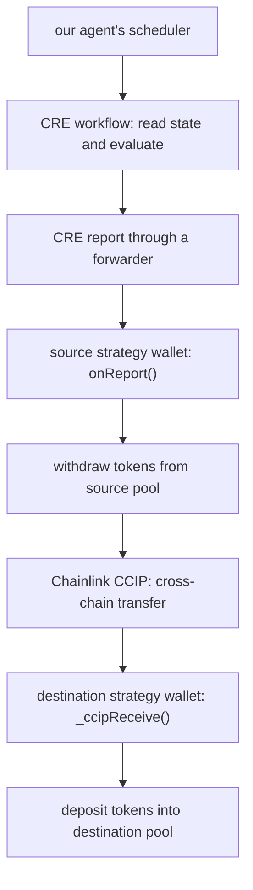

# Locate Arkiv liquidity pool usage

Session: `01a1b309-f209-7da2-bd7d-8192bacbfe44`

Historical transcript. Statements describe what was reported at the time.

## 2026-11-07T04:15:40+05:30 — User prompt

```text
are we using arkiv here? in cde or whenever anything happens in the liquidity pool?

```

## 2026-11-07T04:15:42+05:30 — AI progress update

```text
i’ll check where Arkiv is connected and whether CDE or liquidity pool activity writes to it.
```

## 2026-11-07T04:16:10+05:30 — AI response

```text
yes, Arkiv is used in this project. however, it is currently separate from the lending and liquidity pool flow. i’m assuming by “CDE” you mean Chainlink CRE.

the current code works like this:

- ordinary background tasks use Arkiv for saved progress and restart recovery. Arkiv is the default task backend. [source](<project>/agent/config.py:53)
- lending plans and operation records are encrypted and saved in a local SQLite table called `lending_private`. that save function does not write to Arkiv. [source](<project>/agent/lending.py:138)
- CRE evaluates whether funds should move. the execution workflow can submit the approved action to the strategy wallet, which handles the cross-chain transfer. that workflow does not publish its decisions or results to Arkiv. [source](<project>/cre-lending/part3/workflow.ts:65)

so, a deposit, withdrawal, rate change, or cross-chain move does **not automatically create an Arkiv record**. the lending flow tracks its operations through local records and checks the relevant blockchain state.

the practical consequence is that Arkiv can recover ordinary tasks, but it cannot currently reconstruct the lending plan and operation history if the local lending database is lost. the lending documentation explicitly confirms this boundary. [details](<project>/docs/lending-part4.md:206)

if the intended behavior is to keep a recoverable lending history on Arkiv, that connection still needs to be added. this answer is based on the current code, without a live transaction check.
```

## 2026-11-07T05:24:05+05:30 — User prompt

```text
if we were to connect arkiv what would happen what would it even store and where can i see it just give me xample no need to do it rn

```

## 2026-11-07T05:24:22+05:30 — AI response

```text
Arkiv would hold a saved history of what your agent decided, what it tried to do, and what actually happened to your funds.

for example, imagine you have 100 test tokens deposited in pool A, and the agent decides to move them to pool B.

we could save these records:

1. “move proposed”
   - amount: 100 tokens
   - from: pool A on Ethereum Sepolia
   - to: pool B on Base Sepolia
   - reason: pool B’s rate is higher and the expected benefit exceeds the transfer cost
   - the rates, estimated fees, and your approved limits used for that decision

2. “transfer submitted”
   - a unique operation ID linking this to the decision
   - the source transaction hash
   - the cross-chain message ID
   - status: waiting for delivery

3. “destination deposit verified”
   - the destination transaction hash
   - amount actually deposited: 100 tokens
   - the pool address and verified position
   - completion time

if the transfer arrived but the deposit failed, the final record would say “tokens arrived, deposit failed.” it would keep that distinction so the agent knows what needs recovery.

we could also save an encrypted copy of your management plan: how much it can manage, your fee limit, when to stop, and which operations are pending. private keys would stay outside Arkiv.

you’d see this in two places:

- in the app or WhatsApp, if we connect the history view: “show my last move” could read Arkiv and explain the decision, progress, and transaction links.
- on Arkiv’s Rabdi explorer: each storage write would have a transaction link. a query tool could retrieve the actual records. encrypted contents would need your app’s decryption key to become readable.

your tokens would still live in the wallets and pools on their respective chains. Arkiv would store the history and recovery information. a saved “completed” record should only be created after checking the actual destination deposit.

that’s a possible design, not something the current lending flow already does.
```

## 2026-11-07T05:27:00+05:30 — User prompt

```text
can you explain me exact how and where have we used chainlink wrt tot eh smartcontract and the code for it 

```

## 2026-11-07T05:27:03+05:30 — AI progress update

```text
i’ll trace how the Chainlink workflows connect to our contracts, then show you the relevant code and what each part does.
```

## 2026-11-07T05:27:08+05:30 — AI progress update

```text
the code uses two Chainlink components: CRE runs the decision and execution workflows, and CCIP carries tokens between chains. i’m using the Chainlink CRE and CCIP skills to check the exact handoff between those workflows and our smart contracts.
```

## 2026-11-07T05:27:27+05:30 — AI progress update

```text
the key connection is in `ExecutionStrategyWallet`: CRE calls its `onReport()` entry point, and that function withdraws from the pool and calls CCIP. on the destination chain, CCIP calls a different entry point that deposits the delivered tokens into the destination pool.

the interest-rate comparison is our own code running inside CRE. the pool itself is our test contract, with a configured rate.
```

## 2026-11-07T05:28:02+05:30 — AI response

````text
we use Chainlink in two places in the lending flow:

- CRE, the Chainlink Runtime Environment, runs our workflow: read the contracts, check whether a move makes sense, and submit an execution instruction.
- CCIP, the Cross-Chain Interoperability Protocol, transfers the tokens and an accompanying message between chains.

our strategy wallet contract connects those two pieces. our pool contract handles deposits and withdrawals.

here’s the implemented path:



i’ll walk through it using an example: moving 100 test tokens from a pool on Ethereum Sepolia to a pool on Base Sepolia.

1. our agent starts the check

the schedule lives in our Python application. [`Runtime.worker()`](<project>/agent/runtime.py:95) calls the lending worker, which checks whether a plan is due.

the application then invokes the CRE command-line tool through [`scripts/part4/rules.mjs`](<project>/scripts/part4/rules.mjs:15).

with real testnet observations, it selects the read-only CRE workflow. for the mock arithmetic demonstration, it selects `arithmetic-check`.

so the recurring timer is currently our application’s responsibility. the code invokes CRE when it needs an evaluation.

2. CRE reads our contracts and runs our decision logic

the read-only workflow is in [`cre-lending/workflow/workflow.ts`](<project>/cre-lending/workflow/workflow.ts:17).

it creates a Chainlink `EVMClient` for each chain and calls our strategy wallet’s read functions:

- `observe()` returns the pool rate, deposited amount, available liquidity, deposit capacity, and relevant balances.
- `binding()` identifies the wallet’s configured owner, pool, token, policy, and other settings.
- `quoteLink()` asks for the estimated CCIP fee in LINK.

you can see exactly what `observe()` returns in [the contract](<project>/contracts/src/lending/part3/ExecutionStrategyWallet.sol:356).

the workflow then calls our own evaluator:

```ts
const result = evaluateRun(p.observation.run, () => now);
if (result.decision.action !== 'move')
  return JSON.stringify({ submitted: false, result });
```

that excerpt is from [the execution workflow](<project>/cre-lending/part3/workflow.ts:76). the underlying financial rules live in [`lending/decision.ts`](<project>/lending/decision.ts:55).

those rules compare the expected additional return against costs and check your limits. Chainlink provides the execution environment and blockchain access. we wrote the rules that decide `move`, `hold`, or `blocked`.

3. CRE sends an instruction to our strategy wallet

when a move is permitted, our application prepares an instruction containing the amount, destination, expiry, fee limits, and other constraints. the approved owner wallet signs that exact instruction. this happens in [`scripts/part4/live.mjs`](<project>/scripts/part4/live.mjs:210).

the execution workflow rechecks the observations and current contract state. it then creates a report:

```ts
const report =
  runtime.report(prepareReportRequest(encodeExecutionReport(p))).result();
```

after the preflight branch, it submits that report:

```ts
const written = source!.client.writeReport(runtime, {
  receiver: i.consumer,
  report,
  gasConfig: { gasLimit: '1500000' }
}).result();
```

both calls are in [`cre-lending/part3/workflow.ts`](<project>/cre-lending/part3/workflow.ts:80).

a report is the encoded execution instruction. the forwarder is the contract that delivers it to our contract’s `onReport()` function. that is the CRE-to-smart-contract connection described in [Chainlink’s consumer documentation](https://docs.chain.link/cre/guides/workflow/using-evm-client/onchain-write/building-consumer-contracts).

4. our source contract checks the instruction and calls CCIP

the main contract is [`ExecutionStrategyWallet.sol`](<project>/contracts/src/lending/part3/ExecutionStrategyWallet.sol:206).

its `onReport()` function checks that:

- the caller is the configured forwarder.
- the owner signed the instruction.
- the chain, destination wallet, token, and policy match.
- the instruction is still valid and hasn’t already been used.
- the amount matches the managed pool position.
- reserve and fee limits are respected.

only after those checks does this actual code run:

```solidity
pool.withdraw(i.amount, address(this));
asset.forceApprove(address(router), i.amount);
link.forceApprove(address(router), fee);
bytes32 messageId = router.ccipSend(destinationSelector, message);
```

[source](<project>/contracts/src/lending/part3/ExecutionStrategyWallet.sol:237)

in our example, it withdraws the 100 tokens, allows the CCIP router to take them, allows payment of the LINK fee, and submits the cross-chain transfer.

the CCIP message contains the destination strategy wallet, token amount, and an operation ID linking the transfer to our plan. [`_message()` builds it here.](<project>/contracts/src/lending/part3/ExecutionStrategyWallet.sol:182)

5. CCIP delivers to our destination contract, which deposits into the pool

the same strategy-wallet contract also acts as a receiver. it inherits Chainlink’s `CCIPReceiver`.

delivery enters [`_ccipReceive()`](<project>/contracts/src/lending/part3/ExecutionStrategyWallet.sol:249). router authentication comes from `CCIPReceiver`; our code additionally checks the source chain, paired sender wallet, token, amount, and duplicate-operation protection.

it then attempts the destination deposit:

```solidity
asset.forceApprove(address(pool), d.amount);
pool.supply(d.amount);
asset.forceApprove(address(pool), 0);
```

[source](<project>/contracts/src/lending/part3/ExecutionStrategyWallet.sol:285)

if that deposit fails, the contract records the failure and keeps the delivered tokens available for recovery. delivery and successful investment are tracked separately.

our [monitor](<project>/scripts/part3/monitor.mjs:34) checks the source event, CCIP status, and destination deposit evidence before marking the move complete.

6. the pool itself is our code

[`MockPool.sol`](<project>/contracts/src/lending/MockPool.sol:7) implements `supply()`, `withdraw()`, and balance accounting. its rate is set by its owner through `setCurrentLiquidityRate()`.

that rate is a test value. this pool does not accrue actual interest, and this lending calculation does not obtain its rate from a Chainlink price feed.

there are also two other contracts worth distinguishing:

- [`TestStrategyWallet.sol`](<project>/contracts/src/lending/TestStrategyWallet.sol:155) is the earlier version with cross-chain execution disabled.
- [`CCIPSender.sol`](<project>/contracts/src/CCIPSender.sol:44) is the separate direct-transfer path. it sends through CCIP and pays its fee in native currency. the lending strategy above pays CCIP fees in LINK.

one important qualification: the current application invokes CRE locally through `cre workflow simulate`, with `--broadcast` added for the execution path. it uses a testnet mock forwarder and requires the separate owner signature. this is not evidence of a workflow running autonomously on a decentralized Chainlink network. i’ve traced the current source here; i haven’t verified a new live transfer in this check.
````

## 2026-11-07T06:18:37+05:30 — User prompt

```text
so are we actually using Chainlink or just simulating it? what would we need to change to run this on Chainlink's network? also do we need to show the simulation on the terminal if yes how?

```

## 2026-11-07T06:18:40+05:30 — AI progress update

```text
i’ll check our CRE targets and Chainlink’s deployment requirements so i can distinguish local execution, real testnet transactions, and running the workflow on Chainlink’s network. i’ll also check the exact terminal commands for demonstrating it.
```

## 2026-11-07T06:19:01+05:30 — AI progress update

```text
the account check confirms the distinction: CRE deployment access is currently “not enabled,” and the configured private registry has no deployed workflows. so this project is using the real CRE tooling locally, but its workflows aren’t running on Chainlink’s network.

i’m checking the demo command next. a local CRE run can still submit real testnet transactions when `--broadcast` is used, so “simulation” and “fake transaction” aren’t the same thing.
```

## 2026-11-07T06:19:58+05:30 — AI response

````text
yes, we’re using real Chainlink software, but our CRE workflows currently run locally. they are not deployed to Chainlink’s network.

i checked the account just now:

- CRE login works.
- deployment access says `Not enabled`.
- the private registry configured by our project contains no deployed workflows.

there are three different things to distinguish:

- local CRE simulation runs our actual workflow using Chainlink’s runtime on this computer. depending on the workflow, it can read real blockchain data.
- simulation with `--broadcast` still runs the workflow locally, but can send a real testnet transaction. that transaction can initiate a real CCIP transfer.
- a deployed CRE workflow runs on Chainlink’s decentralized oracle network, meaning Chainlink’s nodes execute it instead of this computer. [simulation documentation](https://docs.chain.link/cre/guides/operations/simulating-workflows)

so our CRE integration is real, but local. our CCIP integration can use the real testnet network when transactions are submitted. i haven’t checked a current CCIP message here, so i’m not claiming a completed live transfer.

to run this on Chainlink’s network, we’d need these changes:

1. get deployment access enabled.

   the account needs approval from Chainlink. `cre account access` starts that process. our configuration already selects the private registry, which can deploy workflows that execute on the public Chainlink network. “private” describes workflow registration, not local execution. [deployment guide](https://docs.chain.link/cre/guides/operations/deploying-to-private-registry-ts)

2. replace local CLI invocation with requests to the deployed workflow.

   today, [`cre-execution.mjs`](<project>/scripts/part4/cre-execution.mjs:40) starts `cre workflow simulate`. we’d change that integration to trigger the deployed workflow and track its execution.

   our workflow currently has an empty `authorizedKeys` list. we’d configure an authorized caller and use Chainlink’s authenticated HTTP trigger. the simplest first version could keep our application’s timer while moving workflow execution onto Chainlink. [HTTP trigger documentation](https://docs.chain.link/cre/guides/workflow/using-triggers/http-trigger/configuration)

3. adapt the strategy contracts for deployed reports.

   the current path uses mock forwarders. we’d use the appropriate network forwarders and verify the deployed workflow’s identity.

   there’s a specific code change needed: our contract currently treats the workflow owner and the owner of the funds as the same address. private-registry workflows use the organization’s owner address, which can differ from the wallet holding the funds. those permissions need separate fields, while preserving the wallet’s signature requirement.

   the current contract’s forwarder and workflow ID are immutable, so this requires new strategy-wallet deployments and a reviewed migration of any existing position. [current contract](<project>/contracts/src/lending/part3/ExecutionStrategyWallet.sol:39)

4. verify the complete deployed flow.

   we’d check a network execution, its source transaction, the CCIP message, and the destination deposit. the existing financial rules and much of the CCIP contract logic can remain. local policy storage and recovery would still need attention if we also wanted operation independent of this computer.

for a demo, i recommend showing the terminal simulation. it makes the integration visible. whether it is mandatory for a particular submission depends on that submission’s rules.

i just ran our existing arithmetic demo successfully. both the `move` and `hold` cases ran through the actual CRE simulator and matched our expected calculations.

run this from your terminal:

```bash
cd <project>

npm run lending:cre:arithmetic -- \
  ".local/cre-demo-$(date +%Y%m%d-%H%M%S)"
```

it generates fresh example inputs, invokes CRE twice, and saves the logs and results. you’ll see compilation, `[SIMULATION]` logs, and the decisions.

the underlying command looks like this, using the input generated by my check:

```bash
cd <project>/cre-lending

~/.cre/bin/cre workflow simulate arithmetic-check \
  --target local-simulation \
  --non-interactive \
  --trigger-index 0 \
  --http-payload ../.local/cre-terminal-demo-20261107-061904/move-input.json
```

use the first command for repeat demonstrations because it refreshes the time-sensitive inputs.

describe that demo as: “our lending decision logic executing in the Chainlink CRE simulator.” it proves workflow execution and decision logic. it doesn’t demonstrate a cross-chain transfer; for that, show the source transaction, CCIP message, and verified destination deposit alongside it.
````

## 2026-11-07T06:22:50+05:30 — User prompt

```text
will this cause the current cre which is running to fail??

```

## 2026-11-07T06:22:59+05:30 — AI response

```text
the demo i just ran should not interrupt the current CRE flow. it was a separate simulation using example inputs, with no transaction broadcast. i didn’t change the running agent’s configuration or deploy anything.

if you mean moving execution onto Chainlink’s network, that would require a controlled migration. simply switching the current setup could cause failures because:

- the existing strategy wallets expect their configured forwarder.
- deployed workflows have different identity information.
- our application currently expects results from a local CRE process.

we should keep the current flow working while preparing and testing the network version separately. when it’s ready, we’d stop new actions on the old flow, finish any pending transfers, and switch over.

both versions must not manage the same funds simultaneously, because they could attempt conflicting moves.

nothing has been switched over yet.
```
